# Cycle Care: Project Report

**A retrieval-augmented AI companion for PCOS awareness, screening and cycle tracking**

| | |
|---|---|
| **Type** | Educational AI/ML project |
| **Core technique** | Retrieval-augmented generation (RAG) over medical guidelines |
| **Stack** | Node.js, Express, OpenAI and Google Gemini APIs, vanilla HTML/CSS/JS, Twilio WhatsApp |
| **Knowledge base** | 4 documents, 314 pages, 1,218 embedded chunks |
| **Date** | October 2026 |

> This system is for education only. It is not a medical device and does not diagnose. Every clinical statement it makes is grounded in, and cited to, published guidelines.

---

## Table of contents

1. [Abstract](#1-abstract)
2. [Introduction and problem statement](#2-introduction-and-problem-statement)
3. [Objectives](#3-objectives)
4. [System architecture](#4-system-architecture)
5. [Knowledge base and the RAG pipeline](#5-knowledge-base-and-the-rag-pipeline)
6. [LLM layer: providers, retry and fallback](#6-llm-layer-providers-retry-and-fallback)
7. [Prompt engineering and safety](#7-prompt-engineering-and-safety)
8. [Feature modules](#8-feature-modules)
9. [Period tracker algorithms](#9-period-tracker-algorithms)
10. [WhatsApp channel](#10-whatsapp-channel)
11. [Data model and storage](#11-data-model-and-storage)
12. [API design](#12-api-design)
13. [User interface and experience](#13-user-interface-and-experience)
14. [Testing and validation](#14-testing-and-validation)
15. [Results](#15-results)
16. [Limitations and ethical considerations](#16-limitations-and-ethical-considerations)
17. [Future work](#17-future-work)
18. [Conclusion](#18-conclusion)
19. [References](#19-references)

---

## 1. Abstract

Polycystic ovary syndrome (PCOS) affects an estimated 10 to 13% of reproductive-aged women, and up to 70% of them do not know they have it (WHO, 2026). Reliable information is scattered across long clinical guidelines, while general-purpose chatbots can produce confident but unsupported medical claims.

Cycle Care addresses this with a **retrieval-augmented generation (RAG)** architecture. The 274-page International Evidence-Based PMOS (formerly PCOS) Guideline, its 2023 summary, and the WHO and FDA fact sheets are split into 1,218 overlapping chunks and embedded as 1,536-dimension vectors. For every request, the system retrieves the most similar passages by cosine similarity and instructs a large language model (OpenAI GPT-4.1 family or Google Gemini) to answer **only** from those passages and cite them as [S1], [S2] and so on. The retrieved passages, with page numbers and similarity scores, are shown to the user.

On this foundation the project builds six user-facing features:

- a Rotterdam-criteria screening report;
- a streaming chat;
- a period tracker with cycle predictions and an irregularity alert;
- phase-aware movement plans;
- an experimental ultrasound explainer with hallucination safeguards;
- a WhatsApp bot.

---

## 2. Introduction and problem statement

### 2.1 Background

PCOS is a common hormonal condition with reproductive, metabolic and psychological features. In adults, it is diagnosed with the **Rotterdam criteria**: two of the following three, after excluding other causes.

1. Irregular cycles or ovulatory dysfunction
2. Clinical or biochemical hyperandrogenism (for example excess hair growth, acne, raised androgens)
3. Polycystic ovarian morphology on ultrasound, or elevated anti-Müllerian hormone (AMH)

The 2023 international guideline, updated in 2026, also introduced a new name, **polyendocrine metabolic ovarian syndrome (PMOS)**. The new name reflects that the condition is metabolic and endocrine, not about true ovarian "cysts".

### 2.2 Problem

- **Information gap:** guidance exists, but it is long and technical (274 pages), so patients rarely read it.
- **Unreliable AI answers:** general LLMs answer fluently but can invent facts, and they give no way to verify them.
- **Late recognition:** irregular cycles, an early and trackable sign, are often not connected to PCOS until much later.

### 2.3 Proposed solution

An assistant whose answers are **grounded and verifiable**: it retrieves the relevant guideline text first, generates only from that text, and shows its sources. A period tracker links everyday cycle data to the screening logic.

---

## 3. Objectives

| # | Objective | How it is met |
|---|---|---|
| O1 | Answer PCOS questions accurately and verifiably | RAG with mandatory inline citations and visible source passages |
| O2 | Help users judge whether to seek evaluation | Screening report structured around the Rotterdam criteria |
| O3 | Connect cycle tracking to clinical criteria | Tracker computes cycle statistics, flags cycles outside 21 to 35 days, and pre-fills screening |
| O4 | Encourage healthy habits | Daily guideline tip and phase-aware movement plans |
| O5 | Reach users where they are | WhatsApp channel through Twilio |
| O6 | Be safe and honest about limits | Safety prompts, no diagnosis, image pre-check, clear estimate labels |
| O7 | Stay reliable during a live demo | Two providers with retry and automatic fallback |

---

## 4. System architecture

### 4.1 High-level architecture

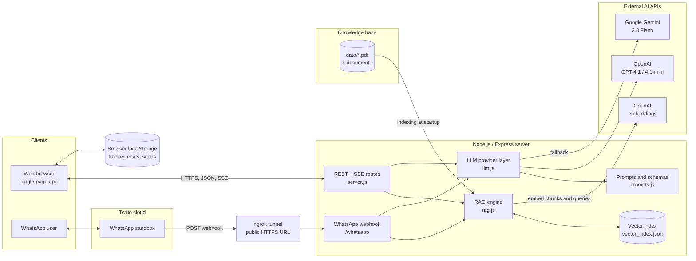

### 4.2 Technology stack

| Layer | Technology | Reason |
|---|---|---|
| Runtime | Node.js 24 | One language across the stack; native streaming |
| Web server | Express 5 | Minimal, well known, easy SSE support |
| PDF parsing | pdf-parse | Page-level text extraction, needed for page citations |
| Embeddings | OpenAI `text-embedding-3-small` (1,536 dims) | Strong retrieval quality at low cost |
| Generation | OpenAI `gpt-4.1-mini`; Google `gemini-3.8-flash` | Fast, structured JSON output, two independent providers |
| Vision | OpenAI `gpt-4.1` | The mini model hallucinated on test images (see section 14) |
| Vector store | Custom in-memory index with a JSON cache | 1,218 vectors need no external database; fully explainable |
| Frontend | HTML, CSS, vanilla JS | No build step; fast to iterate and easy to audit |
| Design system | ChaiUI tokens | Consistent, restrained dark and light theme |
| Messaging | Twilio WhatsApp sandbox and ngrok | Real WhatsApp delivery without a production number |

### 4.3 Request lifecycle

Every AI feature follows the same retrieve, augment and generate pattern:

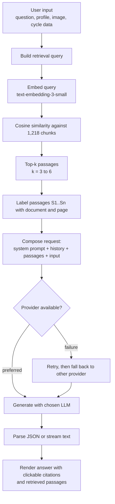

---

## 5. Knowledge base and the RAG pipeline

### 5.1 Documents

| Document | Pages | Chunks |
|---|---:|---:|
| International PMOS (formerly PCOS) Guideline, full, updated 2026 | 274 | 1,067 |
| International PCOS Guideline 2023 (Summary) | 35 | 129 |
| WHO Fact Sheet: PCOS (Jan 2026) | 3 | 13 |
| FDA Fact Sheet: PCOS | 2 | 9 |
| **Total** | **314** | **1,218** |

### 5.2 Indexing pipeline

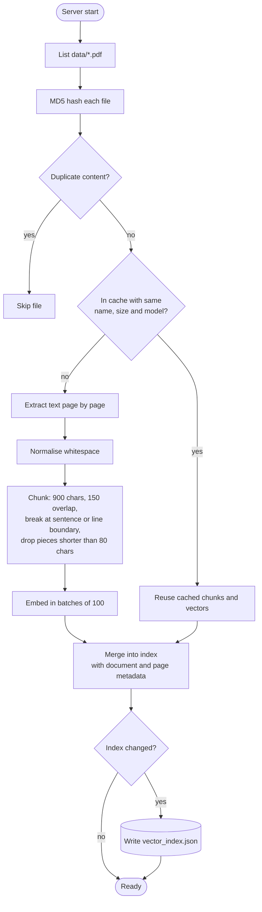

**Design decisions**

- **Page-level extraction:** each chunk keeps its page number, so every citation points to an exact page.
- **Overlapping chunks (150 characters):** a sentence that crosses a chunk boundary still appears whole in at least one chunk.
- **Boundary-aware splitting:** a chunk ends at the last sentence or line break after the halfway point, which avoids cutting sentences in two.
- **Incremental and deduplicated:** adding a PDF embeds only that file. Byte-identical files are detected by MD5 and skipped (two downloaded guideline files were identical).
- **No vector database:** at 1,218 vectors, an exhaustive cosine scan takes milliseconds. It is exact (not approximate), and simple to explain and inspect.

### 5.3 Retrieval

For a query vector **q** and chunk vector **c**:

```
similarity(q, c) = (q · c) / (‖q‖ · ‖c‖)
```

All chunks are scored, sorted and the top k returned (k = 4 for chat, 6 for screening, 3 for tips, 5 for wellness plans). Each result carries `{ doc, page, text, score }`.

Retrieval queries are tailored per feature. For example, screening embeds *"PCOS diagnosis criteria and lifestyle management for: {profile}"*, and the ultrasound chat prefixes *"pelvic ultrasound polycystic ovarian morphology"*.

### 5.4 Context formatting

Passages are injected into the prompt as:

```
[S1] (International PMOS (formerly PCOS) Guideline, full, updated 2026, page 66)
...passage text...

[S2] (International PCOS Guideline 2023 (Summary), page 10)
...passage text...
```

The model cites these labels, and the frontend turns them into clickable chips that open the matching passage.

---

## 6. LLM layer: providers, retry and fallback

`llm.js` hides provider differences behind two functions: `complete()` for whole responses and JSON, and `stream()` for token streaming. Messages use one internal format, `{ role, text, image? }`, which is converted to OpenAI's chat format or Gemini's `contents/parts` format.

### 6.1 Model selection

| Use | OpenAI | Gemini |
|---|---|---|
| Text and JSON | `gpt-4.1-mini` | `gemini-3.8-flash` |
| Requests containing an image | `gpt-4.1` | `gemini-3.8-flash` |

All models can be overridden through environment variables. During development `gemini-2.5-flash` was retired for new users, so the default was updated to the model the API recommended.

### 6.2 Reliability strategy

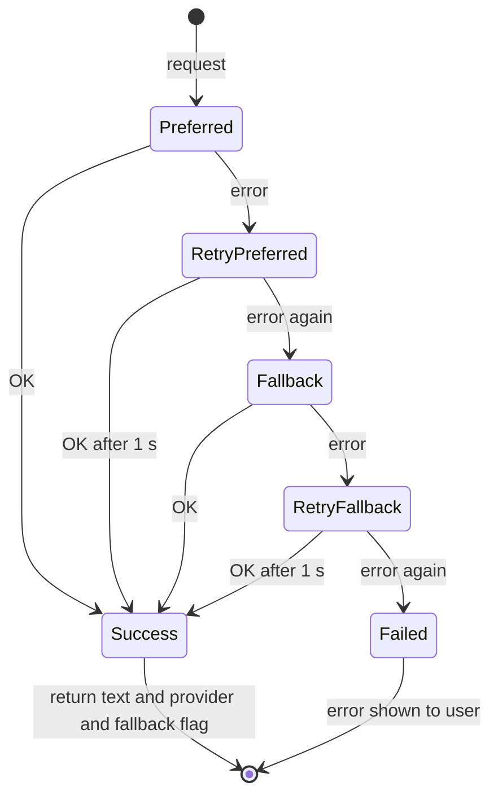

- **Whole responses:** each provider gets two attempts, one second apart, before the other provider is tried.
- **Streaming:** fallback is allowed **only before the first token** is sent, so a user never sees half of one model's answer followed by another model's answer.
- The response includes `fallback: true` when a switch happened, and the UI shows it under the answer. This proved necessary: Gemini returned repeated HTTP 503 "high demand" errors during testing.

---

## 7. Prompt engineering and safety

All prompts live in `prompts.js` and share a common **safety preamble**:

- The assistant is educational and never states that a person "has" PCOS.
- It restates the Rotterdam criteria, so the model reasons with the correct definition.
- It always encourages consulting a qualified professional.

| Prompt | Output | Key rules |
|---|---|---|
| `ASSESS` | Strict JSON | Rotterdam reasoning rules (2 or more domains = High; 1 domain plus supportive features = Moderate); cite every recommendation; a fixed schema with domains, factors, metabolic health, wellbeing, recommendations, next steps, tests and red flags |
| `CHAT` | Markdown text | Answer only from excerpts; say plainly when the answer is not in them; prefer the most recent source when sources disagree; under 200 words |
| `WHATSAPP` | WhatsApp text | `CHAT` rules plus a limit of 120 words and WhatsApp formatting (`*bold*`, `•` bullets) |
| `IMAGE` | Strict JSON | Step 1: decide honestly whether the image is an ultrasound at all. Step 2: describe only visible features; never invent measurements |
| `IMAGE_CHAT` | Text | Image plus earlier analysis plus excerpts; cite medical facts; refuse medical interpretation of non-ultrasound images |
| `TIP` | JSON | One sentence under 30 words, facts only from the excerpts, names its source passage |
| `WELLNESS` | JSON | Adapts to cycle phase and symptoms (gentle movement with cramps or fatigue); cites weekly activity targets |

**Structured output:** JSON prompts use OpenAI's `response_format: json_object` and Gemini's `responseMimeType: application/json`. The server parses the first `{...}` block as a safety net.

**Temperature:** 0.3 for text and 0 for image classification, which reduces variation where accuracy matters most.

---

## 8. Feature modules

### 8.1 PCOS screening

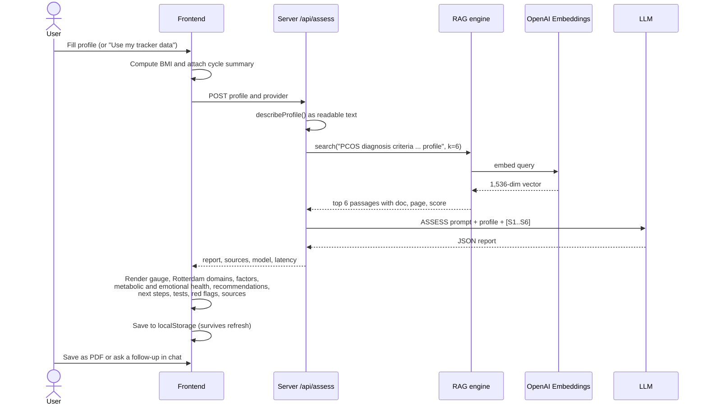

**Inputs:** age, height, weight (BMI is computed), optional waist, cycle length and regularity, tracker summary, five symptoms, six lifestyle and background factors, and free-text notes.

### 8.2 Streaming chat

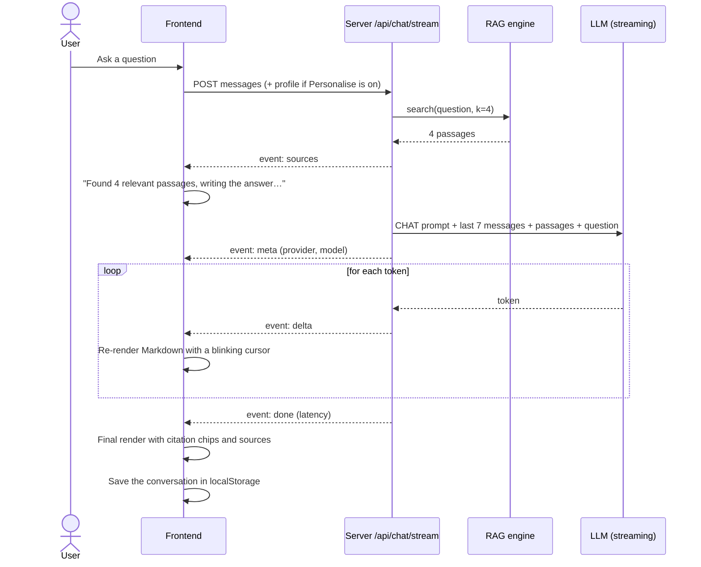

Server-Sent Events are sent over a `POST` response and parsed on the client with a `ReadableStream` reader, because the browser's `EventSource` does not support POST bodies.

### 8.3 Ultrasound explainer (experimental)

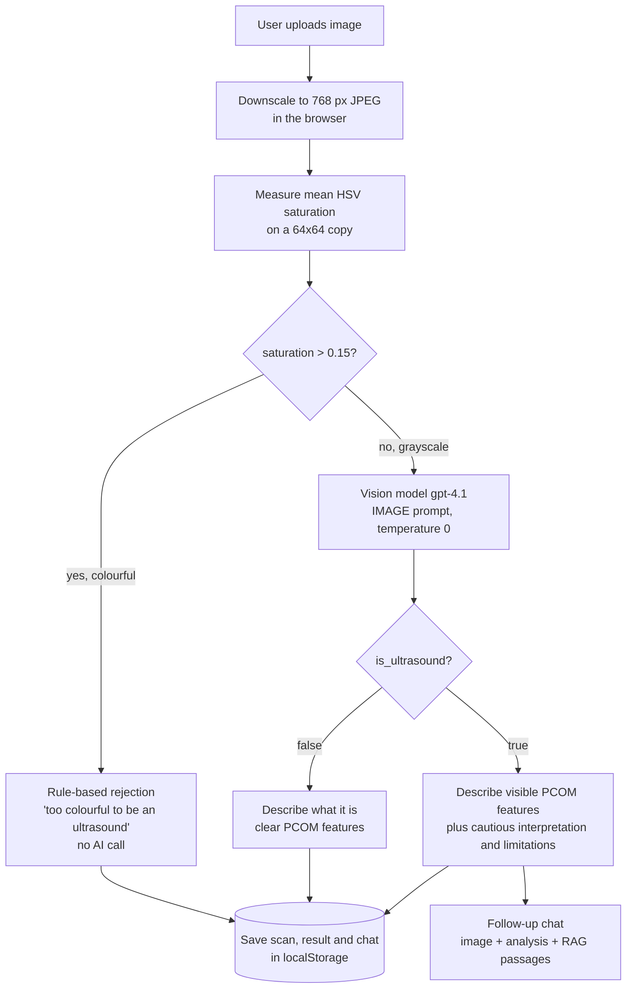

Safeguards are layered because one test exposed a real hallucination (section 14.2): a deterministic colour pre-check, a stronger vision model, an explicit "is this an ultrasound?" first step, and server-side clearing of features when the model says the image is not an ultrasound.

### 8.4 Daily tip and wellness plan

- **Tip of the day:** one of 12 topics is chosen from the day number, the 3 most relevant passages are retrieved, and the `TIP` prompt returns `{ title, tip, source }`. The cited passage's document and page are shown, and the tip is cached in the browser for the day.
- **Movement for today:** a rule-based plan for the current cycle phase appears instantly, switching to gentle options if cramps or fatigue were logged. **Personalise with AI** sends the phase, cycle day, today's symptoms and cycle statistics to `/api/wellness`, which retrieves 5 activity and diet passages and returns exercises, nutrition and self-care tips plus the guideline's weekly target.

---

## 9. Period tracker algorithms

All calculations run in the browser on the user's own data.

### 9.1 From logged days to cycles

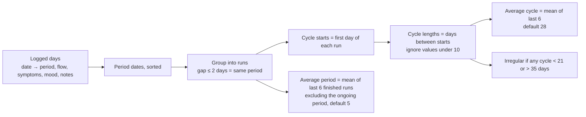

### 9.2 Predictions

Let `L` be the last period start, `C` the average cycle length and `P` the average period length.

| Quantity | Formula |
|---|---|
| Cycle day | `today − L + 1` |
| Next period | `L + C` |
| Estimated ovulation | `next period − 14` |
| Fertile window | `ovulation − 5` to `ovulation + 1` |
| Predicted period days | `L + kC` to `L + kC + P − 1`, for the next 3 cycles |
| Remaining days of an ongoing period | `L + 1` to `L + P − 1` (from today onwards) |

The ovulation estimate assumes a fixed 14-day luteal phase. This is a standard calendar method and is **unreliable with irregular cycles**, which is why the UI labels every prediction as an estimate and warns against using it for contraception.

### 9.3 Cycle phase

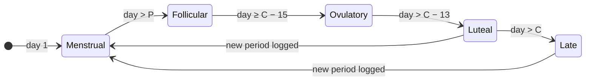

### 9.4 From tracker to screening

When three or more periods give at least two cycles, the insights panel compares each cycle with the guideline definition of regular cycles (21 to 35 days). If any cycle falls outside it, the panel explains that this suggests ovulatory dysfunction, one of the Rotterdam criteria, and offers **Run screening with my cycle data**. That button fills the form with the average length and regularity, and adds a summary such as *"6 cycles tracked, average 41 days (range 33 to 52), 5 outside the 21 to 35 day range"*, which is sent to the LLM.

---

## 10. WhatsApp channel

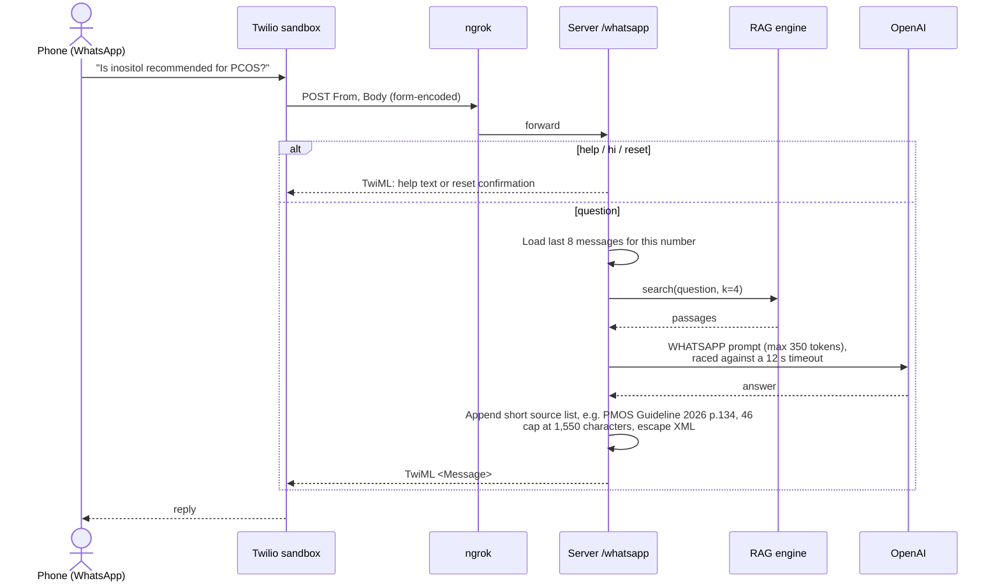

**Design constraints**

- Twilio abandons a webhook after **15 seconds**, so the bot always uses the faster OpenAI model, limits output tokens, and races generation against a 12-second timeout with a friendly fallback message.
- WhatsApp messages are limited to 1,600 characters, so replies are capped at 1,550.
- Images sent on WhatsApp get a pointer to the web app's ultrasound feature. The WhatsApp channel is text only, by design.
- `ngrok` starts automatically when `NGROK_AUTHTOKEN` is set, and the server prints the exact webhook URL.

---

## 11. Data model and storage

### 11.1 Server-side

The server stores only the **vector index** (`web/data/vector_index.json`, git-ignored and rebuilt from the PDFs) and **WhatsApp conversation memory** (in memory, the last 8 messages per phone number, cleared on restart). There is no user database: no personal data is persisted on the server.

### 11.2 Client-side (browser localStorage)

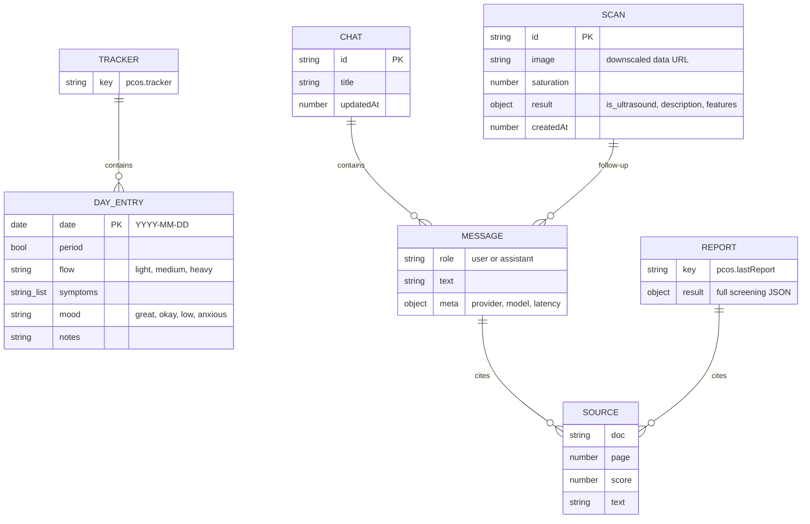

Other keys: `pcos.theme` (dark or light) and `pcos.tip` (today's cached tip). If the browser's storage quota is exceeded, the oldest scans are dropped first.

---

## 12. API design

| Method | Endpoint | Request | Response |
|---|---|---|---|
| GET | `/api/status` | | Index statistics per document, providers, models |
| POST | `/api/assess` | `profile, provider` | `result` (screening JSON), `sources`, `model`, `latencyMs` |
| POST | `/api/chat` | `messages, provider, profile?` | `answer, sources, model` |
| POST | `/api/chat/stream` | same | SSE: `sources` → `meta` → `delta`* → `done` or `error` |
| POST | `/api/image` | `image` (data URL), `saturation, provider` | `result` (image JSON), `model` |
| POST | `/api/image/chat/stream` | `image, analysis, messages, provider` | SSE as above |
| POST | `/api/tip` | `provider, seed` | `title, tip, topic, source{doc,page}` |
| POST | `/api/wellness` | `phase, cycleDay, symptoms, cycleSummary, provider` | `result` (plan JSON), `sources` |
| POST | `/whatsapp` | Twilio form fields `From, Body, NumMedia` | TwiML XML |

Every JSON route reports `latencyMs`, `provider`, `model` and `fallback`, which the UI shows under each answer for transparency.

---

## 13. User interface and experience

### 13.1 Information architecture

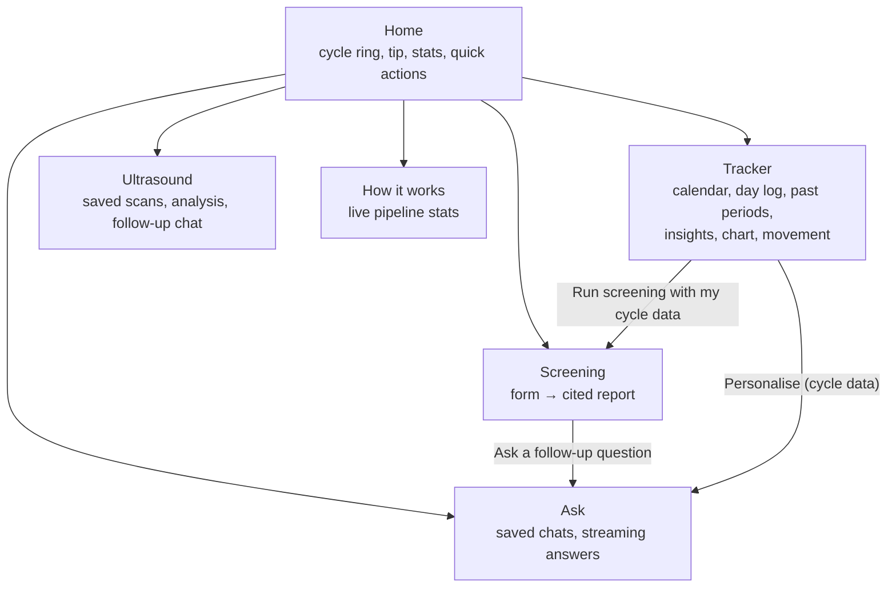

### 13.2 Design system

The interface follows **ChaiUI** design tokens, applied in plain CSS without a framework:

- **Dark by default**, with a near-black background, a faint hexagon pattern and a warm glow that fades towards the bottom. A light theme is available through a toggle, and the choice is remembered without a flash on load.
- **Typography:** Manrope for text and Montserrat for a single cream "highlight" phrase per paragraph.
- **Surfaces:** warm hairline cards with a slight blur and no shadows.
- **Buttons:** one solid button per screen with asymmetric corners, mirrored outline buttons beside it.
- **Colour for meaning only, as text or outline:** red for period and high, green for fertile, low and in range, yellow for moderate. Status is never shown as a filled pill.
- **Responsive:** a top navigation bar on desktop and a bottom tab bar on phones, with every grid collapsing to one column.
- **Accessibility:** focus outlines, ARIA labels, `prefers-reduced-motion` support and no horizontal scrolling at phone width.

### 13.3 Engagement features

Daily tip, logging streak, cycle ring, phase-aware suggestions, one-tap logging, saved history for chats, scans and the last report, and links that carry the user from one feature to the next.

---

## 14. Testing and validation

### 14.1 Approach

| Level | Method |
|---|---|
| API | `curl` scripts for every endpoint on both providers, including invalid input |
| Retrieval | Manual relevance checks of top-k passages for known questions (for example, exercise targets retrieve guideline p.21) |
| Frontend | Headless DOM tests (jsdom) that load the page, click through every tab, load sample data, log days, add past periods, toggle the theme and check for runtime errors |
| Safety | Adversarial images (colour gradient, grayscale stripes) sent to both vision models |
| Channel | Simulated Twilio webhook requests (`help`, a question, `reset`) |

### 14.2 Notable findings and fixes

| # | Finding | Fix |
|---|---|---|
| 1 | **Vision hallucination:** `gpt-4.1-mini` described a plain orange gradient as "a pelvic ultrasound showing an ovary with multiple small follicles". | Switched images to `gpt-4.1`, added a step 1 "is this an ultrasound?" check, a deterministic saturation pre-check, and server-side clearing of features. All four adversarial images are now rejected by both providers. |
| 2 | `gemini-2.5-flash` returned 404 (retired for new users). | Default updated to `gemini-3.8-flash`; models are configurable. |
| 3 | Gemini returned intermittent 503 "high demand" errors. | Retry with backoff and automatic provider fallback, shown in the UI. |
| 4 | Two downloaded guideline PDFs were byte-identical. | MD5 deduplication in the indexer. |
| 5 | WhatsApp source lines were too long because of full document titles. | Grouped short source names, e.g. "PMOS Guideline 2026 p.41, 244". |
| 6 | The tracker-to-screening button crashed (named form-control access). | Switched to `form.elements`; caught by the headless test. |
| 7 | A just-started period made the average period length 1 day. | Ongoing periods are excluded from the average. |
| 8 | "Log today" gave no visible feedback. | Changed it to a state-aware button that logs the day, shows the expected period on the calendar, confirms with a message and highlights the day panel. |

### 14.3 Performance (observed during testing)

| Operation | Typical latency |
|---|---|
| Chat answer (OpenAI, streamed) | First passages in under 1 s, full answer in about 3 to 5 s |
| Screening report (OpenAI) | About 7 to 8 s |
| Image analysis (`gpt-4.1`) | About 3 s |
| Gemini equivalents | About 10 to 15 s |
| Index load from cache | About 1 to 2 s |
| First-time indexing (314 pages) | About 1 minute, roughly $0.01 |

---

## 15. Results

Example outputs:

- **"What is the follicle count threshold for PCOM?"** → *"Follicle number per ovary (FNPO) ≥ 20 in at least one ovary [S2][S3][S4]… FNPS ≥ 10 if image quality is insufficient"*, cited to the full guideline (p.66) and the 2023 summary (p.10).
- **"Is metformin recommended for PCOS?"** → recommended primarily for metabolic features, especially with BMI ≥ 25 kg/m², with citations.
- **"Why was PCOS renamed?"** → explains the PMOS rename from the guideline's opening pages (p.2 and p.5).
- **Screening** of a 24-year-old with 45-day cycles, hirsutism, acne and a BMI of 29.5 → *High likelihood (85 to 90)*. Two Rotterdam domains are marked present, ultrasound or AMH is listed as unknown, and the report includes cited diet, exercise and medical recommendations and a next step to see a clinician this week.
- **Sample tracker data** (cycles of 41, 33, 52, 38, 45 and 36 days) → average 41 days, 5 of 6 cycles flagged as outside the normal range, and an irregular-cycle alert that pre-fills screening.

Every answer can be traced to a specific document and page, which is the core property the project set out to achieve.

---

## 16. Limitations and ethical considerations

**Technical limitations**

- The screening level is an LLM judgement guided by rules, **not a calibrated probability**. It has not been validated against clinical outcomes.
- Retrieval quality depends on chunking and embeddings. Tables and figures in PDFs extract poorly.
- Calendar predictions assume a 14-day luteal phase and are unreliable with irregular cycles, which is exactly the PCOS case.
- The ultrasound feature is not a validated medical model. It describes images and does not measure them.
- There are no accounts: data lives in one browser, and WhatsApp memory resets on restart.
- The WhatsApp webhook does not yet verify Twilio signatures.

**Ethical safeguards built in**

- It never diagnoses, and it states the need for clinical evaluation.
- Sources are always visible, so users and clinicians can verify every claim.
- Estimates are labelled as estimates, with an explicit warning against contraceptive use.
- No personal health data is stored on the server.
- Body-weight language follows the guideline's emphasis on avoiding weight stigma.

---

## 17. Future work

1. **Modular codebase:** separate `backend/` (routes, services, prompts) and `frontend/` (ES modules per feature).
2. **User accounts and cloud sync:** authentication plus a database for tracker data, chats and reports, with encryption and consent.
3. **RAG evaluation:** a labelled question set to measure retrieval recall@k and answer faithfulness, then compare chunk sizes, hybrid (keyword plus vector) search and re-ranking.
4. **Trained ML models:** a symptom-based classifier and a validated ultrasound model trained on clean, representative clinical data, combined with the LLM explanations.
5. **WhatsApp:** Twilio signature verification, persistent memory, cycle logging by message, and reminders.
6. **Localisation:** answers in Hindi, Marathi and other languages.
7. **Deployment:** hosting on a platform with a stable HTTPS URL, removing the need for ngrok.

---

## 18. Conclusion

Cycle Care shows that retrieval-augmented generation can turn a 274-page clinical guideline into an assistant that is useful, interactive and, most importantly, **verifiable**. Every answer is tied to a document and page, and the system is designed to be honest about uncertainty. It uses safety prompts, deterministic pre-checks, provider fallback and clear labelling of estimates. Combining the AI layer with a practical period tracker links daily self-observation to the clinical criteria that matter for PCOS, which helps users take informed questions to a healthcare professional.

---

## 19. References

1. Teede H.J. et al. *International Evidence-based Guideline for the Assessment and Management of Polycystic Ovary Syndrome 2023* (updated as polyendocrine metabolic ovarian syndrome, PMOS). Monash University, 2023, updated 2026. https://www.monash.edu/medicine/mchri/pcos/guideline
2. Teede H.J. et al. *Recommendations from the 2023 International Evidence-based Guideline for the Assessment and Management of Polycystic Ovary Syndrome.* Journal of Clinical Endocrinology & Metabolism, 108(10), 2447 to 2469, 2023.
3. World Health Organization. *Polycystic ovary syndrome: fact sheet.* 22 January 2026. https://www.who.int/news-room/fact-sheets/detail/polycystic-ovary-syndrome
4. U.S. Food and Drug Administration. *Polycystic Ovary Syndrome (PCOS) fact sheet.* https://www.fda.gov/consumers/womens-health-topics/polycystic-ovary-syndrome-pcos
5. Lewis P. et al. *Retrieval-Augmented Generation for Knowledge-Intensive NLP Tasks.* NeurIPS, 2020.
6. OpenAI. *Embeddings and Chat Completions API documentation.* https://platform.openai.com/docs
7. Google. *Gemini API documentation.* https://ai.google.dev/gemini-api/docs
8. Twilio. *WhatsApp Sandbox and TwiML documentation.* https://www.twilio.com/docs/whatsapp
9. ChaiUI. *Design system documentation.* https://ui.chaicode.com
10. Wikimedia Commons. *Ultrasound images of polycystic ovaries* (sample test images, CC licences). https://commons.wikimedia.org/wiki/Category:Ultrasound_images_of_polycystic_ovaries
